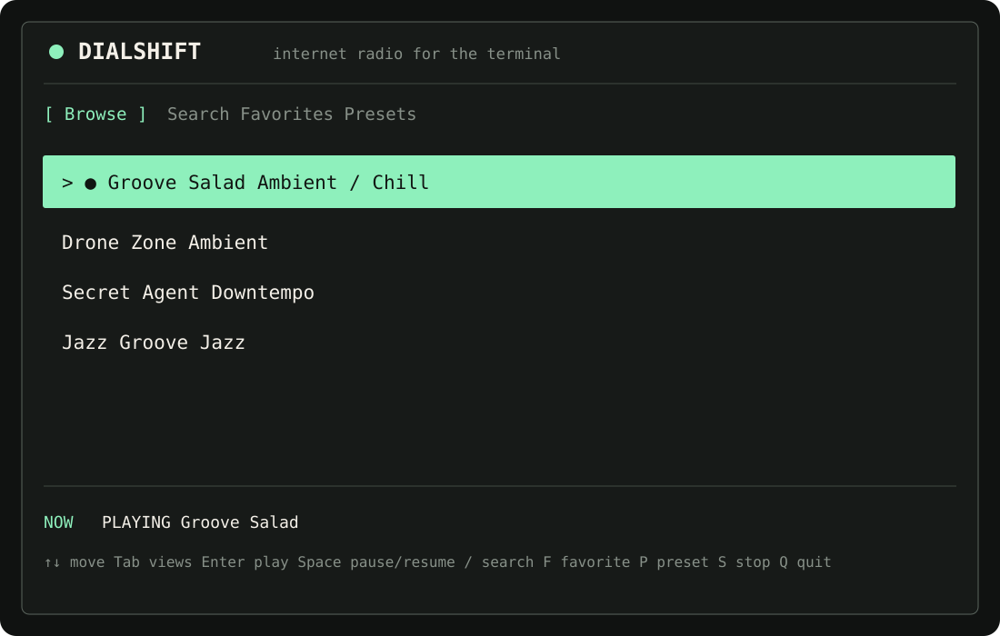

# `> DIALSHIFT`

Internet radio. In your terminal.



Dialshift is a Node.js terminal radio player with station discovery, saved favorites, portable named presets, and a local playback session you can control from any shell.

> **Repository link:** add the public GitHub repository URL here before submitting or publishing. This workspace does not yet have a Git remote.

## Install

Dialshift needs Node.js 20 or newer and [`mpv`](https://mpv.io/) for audio playback.

```bash
brew install mpv                 # macOS (verified)
npm install -g dialshift         # after the package is published
dialshift
```

This repository can be run before publishing with:

```bash
npm install
npm run build
npm link
dialshift --help
```

macOS is the verified target. The player uses Unix-domain sockets for local playback control, so Linux should work where Node and `mpv` are available; Windows has not been tested.

## Listen

```bash
dialshift                         # interactive radio tuner
dialshift search jazz             # directory search by name or genre
dialshift favorite "Groove Salad" # save a starter or custom station
dialshift play focus              # play a preset in the background
dialshift next                    # move through the active preset
dialshift pause
dialshift resume
dialshift stop
dialshift status
```

`play` resolves a preset name first and then a saved station name or ID. Quote names with spaces. It starts a detached, user-local playback session, so closing the interactive tuner does not stop an explicitly started session. `dialshift stop` ends that session cleanly.

## Manage stations and presets

```bash
dialshift add "Campus FM" https://radio.example.edu/live "College radio"
dialshift edit custom-campus-fm-abc "Campus FM HD" https://radio.example.edu/hd Radio
dialshift remove custom-campus-fm-abc

dialshift preset create focus groove-salad jazz-groove
dialshift preset rename focus deep-focus
dialshift preset reorder deep-focus jazz-groove groove-salad
dialshift preset delete deep-focus
```

A preset is an ordered list of station IDs. When a preset stream cannot start, Dialshift tries each later station once and reports the final failure if none starts.

## Keyboard controls

| Key | Action |
| --- | --- |
| `↑` / `↓` | Move selection |
| `Tab` | Switch Browse, Search, Favorites, Presets |
| `Enter` | Play selected station or preset |
| `Space` | Pause or resume |
| `/` | Search the radio directory |
| `F` | Favorite / unfavorite selected station |
| `P` | Create a preset from a favorite |
| `S` | Stop playback |
| `Q` | Quit the tuner |

Search and preset fields capture normal typing. Escape leaves a search or field. Colors are suppressed when `NO_COLOR` is set, and the layout shortens in narrow terminals.

## Storage and portability

Dialshift stores stations and presets at:

```text
$XDG_CONFIG_HOME/dialshift/stations.json
# or ~/.config/dialshift/stations.json
```

Copy that file to the same location on another machine to take presets with you. It has this deliberately portable format:

```json
{
  "version": 1,
  "favorites": ["groove-salad"],
  "customStations": [],
  "presets": [{ "name": "focus", "stationIds": ["groove-salad", "jazz-groove"] }]
}
```

If the config cannot be parsed, Dialshift saves it as `stations.json.corrupt-<timestamp>` and begins with a fresh library, rather than discarding saved data.

## Troubleshooting

- **“mpv is not installed”** — install it using `brew install mpv`, then rerun the play command.
- **No search results or a timeout** — the public Radio Browser directory may be down; favorites and custom stations remain available offline.
- **Playback fails** — confirm that the stream URL opens in `mpv <url>`. Internet streams can disappear without notice.
- **A stale session is reported** — the next `play`, `pause`, `resume`, `next`, or `stop` command replaces the stale local socket automatically.

## Architecture

The CLI and interactive TUI share station validation, storage, directory search, and the playback client. A detached local Dialshift daemon owns one `mpv` process and exposes a filesystem-permissioned Unix socket under the config directory. It sends `mpv` JSON IPC commands for pause, resume, stop, and metadata updates. Search uses the public Radio Browser HTTP API with an eight-second timeout.

## Landing page

The local responsive page is in [`site/index.html`](site/index.html). Serve it with `python3 -m http.server 4173 --directory site` or any static server. It currently uses an SVG product preview derived from the working terminal layout; replace [`site/assets/dialshift-terminal.svg`](site/assets/dialshift-terminal.svg) with a captured terminal screenshot before a public launch. No Git remote was present in this empty workspace, so the landing page’s GitHub links remain placeholders.

## Publishing checklist

Before submitting the GitHub link or publishing to npm:

1. Choose a license and add its `LICENSE` file.
2. Create a **public** GitHub repository, push this project, and replace the repository-link placeholder above.
3. Add the public repository URL to `package.json` under `repository` and `bugs`.
4. Run `npm test`, `npm run lint`, and `npm pack --dry-run`.
5. Sign in to npm, confirm that the `dialshift` package name is available, then run `npm publish --access public`.

`prepack` compiles the TypeScript source, and the npm package includes the resulting `dist/` executable plus the README and license.

## License

No license has been selected. Choose one before publishing a public release.
